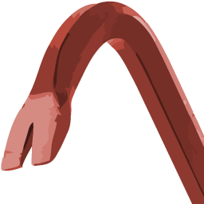

<p align="center">
  
</p>

<h1 align="center">Prybar</h1>

<p align="center">
  <strong>Source engine modding toolkit for AI agents and scripts</strong><br>
  <sub>Rust · MDL 04-53 · VPK / GMA / APK / HFS · CLI + MCP server</sub>
</p>

<p align="center">
  <a href="https://github.com/ds-kimi/prybar/releases"></a>
  <a href="https://github.com/ds-kimi/prybar"></a>
  <a href="LICENSE"></a>
  
  
</p>

<br>

Prybar is a from-scratch Rust toolkit for Source engine modding, with no UI. It decompiles models (MDL, versions 04 to 53) to QC, SMD, VTA and VRD, lists, unpacks and packs VPK and GMA packages, wraps `studiomdl` and `hlmv`, and publishes to the Steam Workshop. It ships as a CLI (`prybar`) and an MCP server (`prybar-mcp`) so Claude, Codex, Cursor and scripts can drive it.

---

## Install

Download a binary from the [releases](https://github.com/ds-kimi/prybar/releases) page, or build it:

```sh
cargo build --release -p prybar-cli -p prybar-mcp
# Workshop publishing needs the Steam SDK: add --features workshop
```

Binaries land in `target/release/` (`prybar`, `prybar-mcp`). Setup details are in [CONTRIBUTING.md](CONTRIBUTING.md).

## Quickstart

```sh
prybar inspect models/props/crate.mdl                       # what is in this model
prybar decompile crate.mdl -o out                           # QC + SMD (+ VTA, VRD)
prybar list pak01_dir.vpk --filter "models/*.mdl" --limit 20
prybar unpack addon.gma -o addon_src
prybar games --detect --save                                # find Steam games once
prybar compile out/crate/crate.qc -g garrysmod              # studiomdl
prybar pack addon_src -o addon.gma                          # needs addon.json
```

Add `--json` for one machine-readable document on stdout. Exit codes are stable: see [docs/cli/README.md](docs/cli/README.md).

## MCP server

`prybar-mcp` speaks MCP over stdio and exposes the same operations as tools (`inspect_model`, `decompile_model`, `list_package`, `unpack_package`, `pack_package`, `compile_model`, `view_model`, `publish_workshop`, `games_list`, `config_get`, `config_set`). Client snippets for Claude Desktop, Claude Code, Cursor, Codex and VS Code: [docs/agents/mcp-config.md](docs/agents/mcp-config.md).

## For AI agents

- Claude Code skill: [skills/claude/prybar/SKILL.md](skills/claude/prybar/SKILL.md)
- Codex, ChatGPT and other agents: [AGENTS.md](AGENTS.md)
- Error reference, recipes, troubleshooting: [docs/agents/](docs/agents/)

## Documentation

| Doc | Content |
|---|---|
| [docs/cli/README.md](docs/cli/README.md) | commands, inputs, JSON output, exit codes |
| [docs/mcp/README.md](docs/mcp/README.md) | MCP tools and safety rules |
| [docs/formats.md](docs/formats.md) | public sources behind each format (clean-room provenance) |
| [docs/roundtrip-report.md](docs/roundtrip-report.md) | decompile, recompile and compare results on real models |
| [CONTRIBUTING.md](CONTRIBUTING.md) | build, test, fuzz, bench |

## License

Prybar is source-available under **MIT + Commons Clause 1.0**. It is not OSI open source.

- Models, addons and anything else you make with Prybar are yours, and commercial use is fine.
- Forks, modifications, republication and free repacks are allowed. Keep the license notice, which carries the credit.
- Do not sell Prybar itself, as is or repacked.

Full text in [LICENSE](LICENSE).

## Thanks

Prybar is inspired by [Crowbar](https://github.com/ZeqMacaw/Crowbar). Thanks to ZeqMacaw for creating it and to everyone who worked on it over the years. Without it, this project would not exist.
